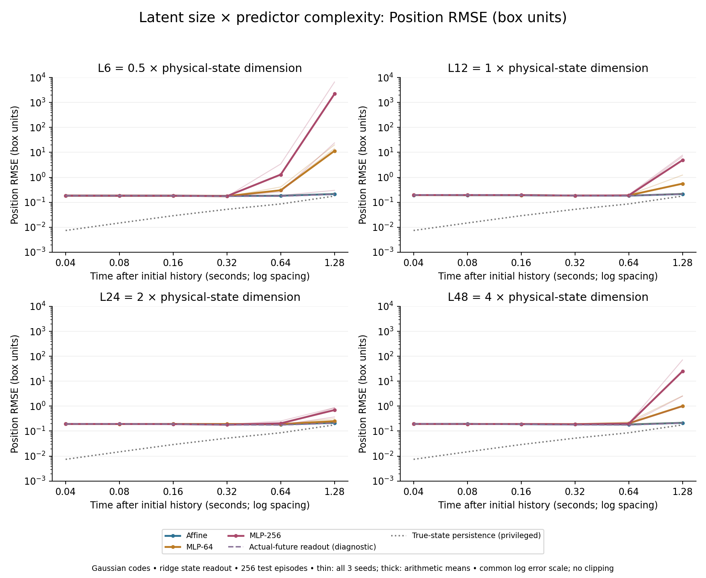
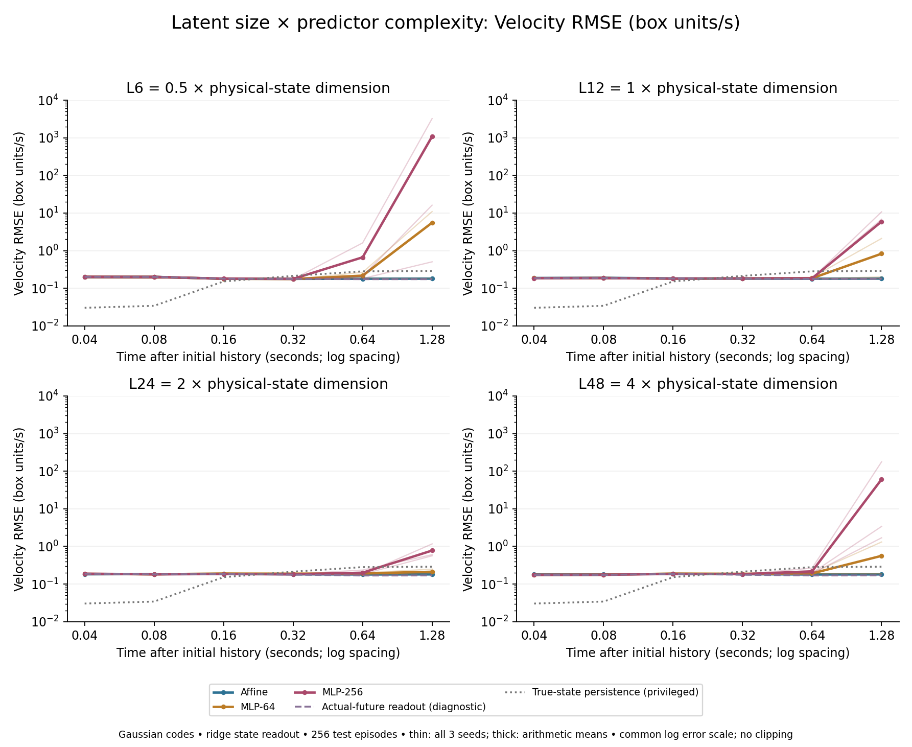

# Billiards capacity results: latent size × predictor complexity

**Saved measurements:** November 5, 2026, 22:00:13 EST.

[Interactive playback and plots](https://henry550xz.github.io/jepa-billiards-demo/capacity.html) ·
[Four-page report PDF](capacity-results-20261105/research-report.pdf) ·
[Numerical curves](capacity-results-20261105/curves.json) ·
[Summary and individual seeds](capacity-results-20261105/summary.json) ·
[Scientific protocol](BILLIARDS_CAPACITY_PROTOCOL.md)

## Research question

Can an image-based world model learn a latent state near the complexity of its
environment, and can a simple predictor evolve that state accurately? We test
the interaction between environment complexity, latent size and predictor capacity.
Gaussian/Sparse is a secondary representation-family check, not the main question.

## What the completed experiments establish

The primary Gaussian sweep is complete: four latent sizes × three predictor
architectures × three seeds, or 12 encoders and 36 frozen-predictor fits. An
additional Sparse L6 block and all nine true-state predictor controls are complete.
The main question is the capacity tradeoff, not an objective-wide Gaussian/Sparse ranking.

**We have not yet demonstrated a reliable image-based physical forecasting
baseline.** The evaluation pipeline and reference controls work, but affine
forecasts have substantial position error and nonlinear predictors can become
unstable when iterated. Even actual-future image readouts have substantial error.
The results therefore characterize the tested models' behavior; they do not
identify the minimum sufficient latent size or simplest successful predictor.
Velocity improvements are reported separately from position accuracy.

## We built a controlled environment

Two colored balls move in a unit 3D box with wall reflections and ball collisions.
For n balls in d spatial dimensions, positions and velocities give 2 × n × d state
coordinates: here 2 × 2 × 3 = 12. That is a physical-state reference, not a claim
that an image encoder learns those coordinates or that its dynamics become linear.
Free motion is simple, while contacts require conditional changes in velocity.
More interacting balls can complicate dynamics without changing the 2 × n × d counting
rule. State dimension and transition complexity are distinct.

The encoder sees three consecutive RGB frames, each containing XY/XZ/YZ views.
The simulator advances by 0.04 s. Dataset: 512 world-training episodes, 128 world
validation, 256 probe-training, 128 probe-validation and 256 disjoint test episodes.
State labels are used for separately fitted diagnostic readouts, not JEPA training.

## We varied representation size and predictor capacity

The fixed image backbone has 12 transformer blocks and width 128. Its history
head produces L = 6, 12, 24 or 48 coordinates: 0.5×, 1×, 2× or 4× the physical-state
dimension. Each encoder trains for 20,000 updates with a common MLP-256 predictor.
We then freeze the encoder and train fresh predictors for 10,000 updates each:

| Predictor | Transition architecture | Parameters at L12 |
|---|---|---:|
| Affine | L → L, weights and bias | 156 |
| MLP-64 | L → 64 → L, GELU hidden layer | 1,612 |
| MLP-256 | L → 256 → L, GELU hidden layer | 6,412 |

Parameter counts also grow with L. This is a width/architecture comparison,
not a parameter-matched comparison. It tests small predictors on already learned
codes; joint representation learning with each small predictor is a separate test.

The completed primary sweep uses Gaussian-regularized codes: four latent sizes ×
three training seeds = 12 encoders and 36 frozen-predictor fits. At test time,
encode only the initial history, then iterate the predictor without future images.
Ridge and MLP state readouts map the predicted codes into physical coordinates.
The main plots use ridge readouts, every test episode, and all three seeds.

## Results: forecast error over time for every setting

See the attached position and velocity plots: four panels for L6/12/24/48, with
affine/MLP-64/MLP-256 curves in each. The time axis is 0.04–1.28 seconds; both axes
use logarithmic spacing. Thin curves show all three seeds; thick curves show
arithmetic means of seed-specific RMSEs. All finite large errors remain included.
Position and velocity are separate metrics, not a combined score.

### Position error over time



[Position plot PDF](capacity-results-20261105/capacity-time-position.pdf)

### Velocity error over time



[Velocity plot PDF](capacity-results-20261105/capacity-time-velocity.pdf)

H32 (1.28 s) position RMSE, box-coordinate units, ridge readout:

| Latent size | Relative to 12D state | Affine | MLP-64 | MLP-256 |
|---:|---:|---:|---:|---:|
| 6 | 0.5× | 0.2144 | 11.5064 | 2208.7420 |
| 12 | 1× | 0.2147 | 0.5574 | 4.8777 |
| 24 | 2× | 0.2145 | 0.2523 | 0.7008 |
| 48 | 4× | 0.2146 | 1.0078 | 24.9261 |

At L12, one-step native feature MSE is 0.139842 / 0.001865 / 0.001510 for affine /
MLP-64 / MLP-256. Larger predictors fit adjacent-code transitions much better,
but this does not guarantee accurate repeated physical forecasts. MLP-256's L12
H32 position RMSEs are 0.218, 6.736 and 7.679 across seeds. Native feature MSE and
physical RMSE have different units; native MSE does not rank latent sizes by
physical quality.

### Why the L48 averages rise

At L48, the H32 position RMSE for each training seed is:

| Seed | MLP-64 | MLP-256 |
|---:|---:|---:|
| 0 | 0.221180 | 71.292391 |
| 1 | 0.215443 | 2.507684 |
| 2 | 2.586658 | 0.978165 |

The MLP-64 mean is raised mainly by seed 2; two seeds stay near the L24 errors.
The MLP-256 mean is dominated by seed 0, although every L48 seed has a larger H32
position error than its corresponding L24 seed. All six L48 MLP runs have lower
one-step native MSE than their corresponding L24 runs. The unstable runs also
show large growth in native latent error, not just error in decoded positions.
Actual-future readout error stays near 0.21 rather than exhibiting a comparable
jump. Thus the observation is seed-sensitive rollout instability, not simply
worse local fitting or uniformly worse decoding of real-image codes.

Repeatedly feeding predictions back into the predictor can amplify deviations
from training codes. This is a possible mechanism, not a causal explanation
established by this sweep. We do not conclude that 48 dimensions are inherently
excessive, or that extra dimensions caused overfitting.

## Findings in the context of the hypothesis

1. **Reducing the code did not make nonlinear prediction easier in this sweep.**
   L6 has much larger nonlinear long-horizon errors than L12 or L24. Increasing
   L24 to L48 does not consistently help. These measurements do not support a
   monotonic rule that smaller or larger codes require simpler predictors.
2. **An affine transition is bounded here, but bounded is not sufficiently accurate.**
   Its position error stays near 0.214 across sizes. Actual-future-image ridge
   readout error is also about 0.21. Nearly equal errors therefore do not establish
   that L6 or L12 is a useful sufficient state.
3. **A physical-state-sized code plus more predictor capacity is insufficient by itself.**
   At L12, much better local fits coexist with seed-sensitive rollout instability.
   The code's information, its coordinate geometry and stability of repeated
   prediction matter alongside dimension. Error accumulation is a possible
   explanation, not a mechanism established by an intervention here.

True-state persistence receives privileged exact initial state: H32 position
RMSE 0.1777 and velocity RMSE 0.2892. Gaussian affine improves velocity to about
0.181, while position remains about 0.214; the metrics must be interpreted
separately. Learned true-state affine/MLP-256 position errors are about 0.1759 /
0.1756, only slightly below persistence; MLP-64 is about 0.2035. Thus encoder
dimension alone is not isolated as the limiting factor. Actual-future readouts
use future images and diagnose state recovery; they are not forecasts. Weak
readout performance does not prove that the latent contains no state information.

**Conclusion:** the completed sweep measures the latent/predictor tradeoff, but
has not identified a minimum useful state size or a necessary predictor width.
A simple predictor may stay bounded, and a larger one may fit locally, without
either producing a useful long-horizon world model at the tested training budget.

## What is complete, queued and proposed

**Complete:** the full Gaussian four-size × three-predictor × three-seed sweep;
an additional Sparse L6 block (3 encoders / 9 predictor fits); all nine true-state
predictor controls. Total: 15 encoders, 45 predictor fits and 30 readouts.

**Already queued:** nine Sparse encoders at L12/24/48, their 27 predictor fits and
18 readouts, and three supervised image-to-state references. The supervised
references check state recovery with the same architecture and budget; they do
not forecast future state. Final validation/aggregation follows these jobs.
Queue verified November 5 late evening (EST): remaining images pending; downstream
work waits on them. The website is a saved results snapshot, not a live queue.

**Proposed, not currently queued:** vary ball count, spatial dimension and
collision regimes, and repeat matched capacity sweeps around each environment's
2 × n × d state size. This would directly test how environment complexity changes the
smallest useful latent and required predictor. Joint training with smaller
predictors and rollout-aware training are separate follow-up options. The current
fixed two-ball environment cannot establish that cross-environment scaling law.

## Visual aid and reproducibility

Demo: https://henry550xz.github.io/jepa-billiards-demo/capacity.html
The demo opens with saved playback, followed by the time-versus-RMSE panels.
The three synchronized panels show exact physics, predicted state and actual-future readout. The first
three test clips are fixed in manifest order, without selecting by model error;
aggregate curves use all 256 episodes. No generated RGB or live inference.

- **Predicted rollout:** encode the initial image history, repeatedly apply the
  learned predictor, then decode each predicted code into physical state.
- **Actual-future readout:** encode real image histories at future times and
  decode their codes, bypassing the predictor. This diagnoses encoder/readout
  state recovery and is not a forecast.
- **Exact physics:** the recorded simulator state, used as ground truth.

To reproduce the two capacity figures from the published aggregate curves:

```bash
python scripts/study/plot_capacity_results.py \
  docs/capacity-results-20261105/curves.json /tmp/billiards-capacity-figures
```

This requires NumPy and Matplotlib and performs no training or inference. The
JSON retains individual-seed curves for every completed predictor and both
state readouts; the static figures use the ridge readout. [checksums.json](capacity-results-20261105/checksums.json)
records the publication asset hashes. The data omit checkpoints, training data,
full per-episode errors, private notes and operational history.

Measurements: November 5, 2026, 22:00:13 EST. Three seeds share the held-out data;
these fixed-budget results do not claim convergence, equivalence or confidence
intervals. Original experiment snapshot identifier (not a commit in this curated repository): `968e6a825be49d662f303cf630315024f2f86d33`.
Numerical snapshot SHA256: `21fe079122d3decc68e57b6e51004abb439a26726aebedb5e6a59aba025b844a`.
This report reuses retained artifacts; no experiment was rerun or retuned.
