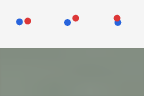

# 3D billiards: preliminary learning and readout diagnostics

The event-driven simulator passes physical validation. The image-based models
remain preliminary: the 1,000-update screening does not establish successful
physical learning or a ranking of objectives. See the [interactive comparison](https://henry550xz.github.io/jepa-billiards-demo/research.html).

## Configuration and provenance

Three objectives × 1,000 updates, seed 0, batch 16, 12 blocks, width 128,
48×144 RGB, history 3, learning rate 0.0003; matched 48-episode training set.
Full protocol and partitions: [methods](BILLIARDS_METHODS.md).

Historical training source: `be7d5bef8e72166a46c0103f26e7fdb3efa438f8`.
Supplemental evaluator: `9b7d1ecc6330345f47d04faffcb48488c0daf48e`.
[Metrics, probes, all test forecasts and image examples](../results/billiards-screening)
were copied against their original SHA256 receipt. Historical checkpoint hashes
and training summaries are in the update provenance manifest; weights are not
included in this release.

## Physical-state recovery

Unit cube; position errors are per-coordinate RMSE in box units. Probe fitting
uses separate labeled episodes after image-only world-model training.

| Method | History-probe position RMSE | History-probe velocity RMSE | Predicted H32 position RMSE | Actual-future H32 probe position RMSE |
|---|---:|---:|---:|---:|
| Pixel | .2140 | .1847 | 158.6851 | .2213 |
| Gaussian | .2114 | .1838 | .2245 | .2213 |
| Sparse | .2116 | .1837 | .2283 | .2189 |

Pixel's enormous values are an unstable predicted-feature readout, not credible
physical coordinates. Gaussian/Sparse errors are also substantial, including when
the readout receives actual future images. These results leave representation,
probe capacity and optimization limitations unresolved.

## Image prediction and feature variation

At H8, the top row shows true XY/XZ/YZ images and the bottom row is Pixel's forecast:

The forecast is largely uniform and does not recover the balls. Pixel's final
feature variance trace was 4.30e-6; Gaussian 84.75; Sparse 21.89, with 59.2% zeros.
Feature scales differ across objectives, so these values cannot rank quality.
Decreasing within-method training loss alone does not show learned dynamics.

## References and collision coverage

Exact initial state plus exact physics has H32 position RMSE 2.72e-16. The learned
privileged affine state reference has .18467. These controls receive true state,
not just RGB histories.

Supervised image-to-state probes followed by exact physics have valid initial
estimates for 9/16 Pixel, 4/16 Gaussian and 9/16 Sparse cases. Valid-subset H32
errors are .2416/.2162/.2379 respectively. Different selected subsets prevent
interpreting those conditional numbers as a fair ranking.

Only two test episodes contain a ball collision by H8. The full dataset has
85 ball-collision intervals among 9,216 intervals. Event-stratified errors and
sample counts are retained; wall and ball categories overlap. The screening is
not yet a complete collision-prediction or probe-capacity study.

## Compute and next diagnostic

| Method | Training seconds | Windows/s | Peak reserved GiB |
|---|---:|---:|---:|
| Pixel | 37.01 | 439.65 | .521 |
| Gaussian | 53.38 | 301.27 | 1.010 |
| Sparse | 53.45 | 300.36 | 1.004 |

These are short-run measurements, not end-to-end study cost or scaling guarantees.

As of 2026-10-17, a bounded diagnostic is in progress: each objective first fits
one training episode for 2,000 updates, then separately trains on all 48 episodes
for 10,000 updates. Physical probes and foreground-sensitive image controls follow
each stage. The run is not yet a completed result in this release. No full factor
ablation is reported. Proposed extensions are described in the methods document.
