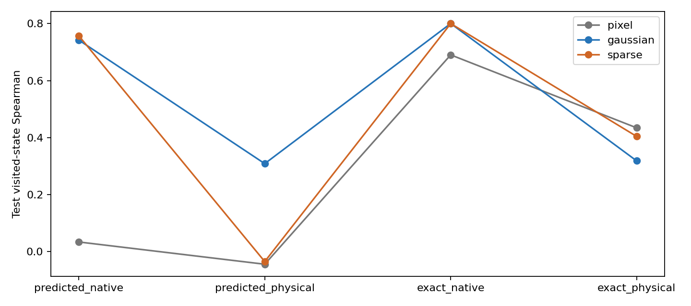
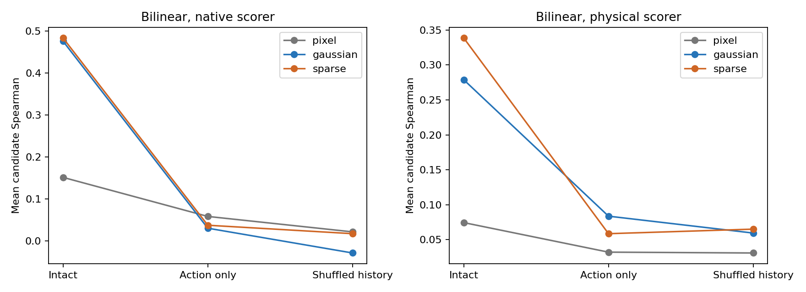
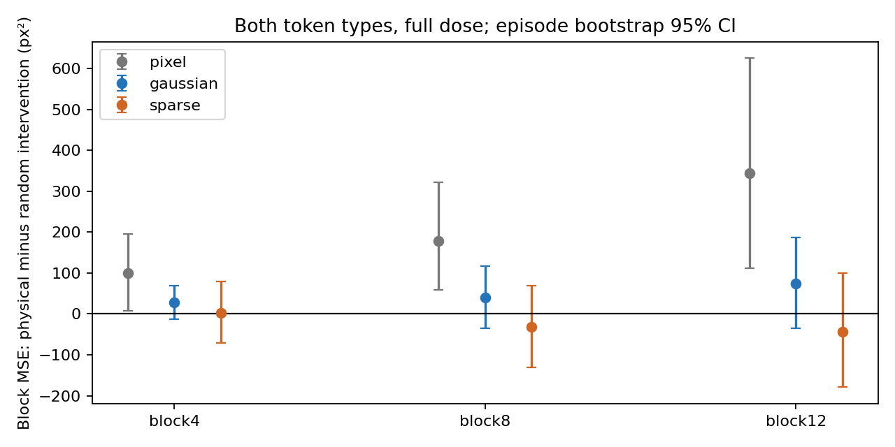
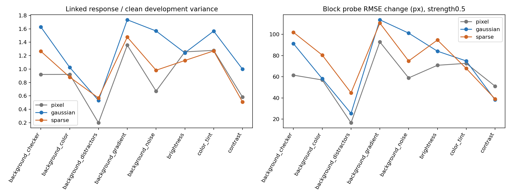
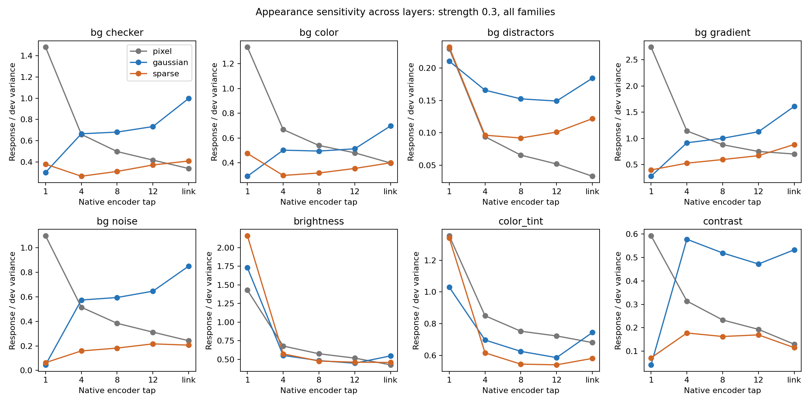

# PushT: representation, dynamics and readout

Completed frozen-checkpoint follow-up on the matched 12-block, seed-0 models.
The strongest supported result is that useful latent dynamics and useful physical
readouts are distinct requirements. No encoder or world-model retraining was used.

Execution source `82aae1e99fe84676194944a59a7ae08301c5b0ec`; analysis source
`74d9016b2025269b07bd583a9a3de3729c22e144`. Compact tables, contrasts and figures
are [retained here](../results/mechanism-followup); copied artifacts were checked
against their original SHA256 receipts. Historical SHAs identify research snapshots,
not commits in this presentation repository.

## 1. Failure localization on states actually visited

Fresh12 test simulator seeds, three learned behavior policies, four sampled
replans per policy:144 test visited-state banks,64 identical candidates per bank,
evaluated by every model. Four additional development seeds are excluded below.
Histories are restored by full action replay. Same physical targets/candidates,
with only latent source and scoring rule varied. Native scores use distance to
encoded goal image; physical scores use the frozen physical probe. Exact-future
rows are diagnostic oracles, not deployable predictions.

Mean candidate Spearman against simulator physical quality:

| Source and scorer | Pixel | Gaussian | Sparse |
| --- | ---: | ---: | ---: |
| Predicted latent, native distance | .034 | .742 | .757 |
| Predicted latent, physical probe | −.044 | .309 | −.035 |
| True-future image, native distance | .690 | .800 | .800 |
| True-future image, physical probe | .434 | .319 | .404 |

Sparse-minus-Gaussian predicted-native correlation difference is+.015, paired
95% seed-cluster interval[−.011,.040]: no resolved native-ranking superiority.
The predicted-physical difference is−.343[−.444,−.236]. Predicted-native regret
is.002570 Gaussian/.002433 Sparse; predicted-physical regret is.006577/.013393.
True-future physical regret is.005861/.003043. Gaussian and Sparse native exact
scores are essentially indistinguishable on this panel.

**Interpretation:** Sparse's native predicted distance retains useful action
ordering, while feeding those predicted latents through the physical readout
substantially damages that ordering. Its physical probe works better on true
future images. This supports a dynamics/readout compatibility failure, rather
than an absence of all useful dynamics in Sparse. It does not prove a specific
manifold mechanism, nor that switching a closed-loop planner's scorer fixes success.
Pixel has a much larger true-versus-predicted gap even with native scoring.

## 2. Reaches then leaves the goal

[Retrospective analysis](REPRESENTATIONS.md) covers450 saved trajectories.
Depth4 Gaussian ever29/50→final7/50; Sparse7/50→0/50. Every ever-successful
trajectory in both groups exhibited at least one later sampled exit; Gaussian
sometimes re-entered. This problem is not exclusive to Sparse.

Fresh full-depth test trajectories (12 per arm) under the unchanged physical
planner give ever/final counts Pixel3/0, Gaussian10/2, Sparse4/0. These small
counts are descriptive, not a replacement for the original50-episode pilot.

In120 replans per arm, the chosen full-horizon action sequence was predicted to
improve physical cost but actually worsened it in75 Pixel,2 Gaussian and5 Sparse
cases. This compares the SAME full horizon in prediction and simulator; the
executed prefix is only one action group. It cannot be interpreted as75/120
actual executed-prefix failures. Sparse's poor completion is not explained simply
by the same gross optimistic-cost error seen in Pixel. True contact events were
not instrumented; distance-based contact labels were not fabricated.

## 3. Is useful dynamics mostly coming from actions?

Three architectures x five taps x three arms x three input conditions =135 small
predictor fits, with frozen encoders and matched1000-step fitting budgets. Nulls
are action-only (state inputs zeroed every step) and unrelated episode histories
(shuffled at fitting; unrelated initial history then recurrent prediction at test).
The intact linked fits reproduce the prior panel's450 bank-score vectors within
tolerance. Thus the controls have not silently replaced the original fit.

Linked bilinear mean candidate Spearman, native / physical scoring:

| Arm | Intact history | Action-only | Shuffled history |
| --- | ---: | ---: | ---: |
| Pixel | .152 / .075 | .059 / .032 | .022 / .031 |
| Gaussian | .476 / .279 | .031 / .084 | −.028 / .060 |
| Sparse | .484 / .339 | .038 / .059 | .018 / .065 |

Native intact-minus-action-only gains: Gaussian+.445[.386,.506],
Sparse+.446[.378,.514], Pixel+.093[.036,.153]. These paired50-bank intervals
support a real contribution from the observed representations in both JEPAs;
the earlier dynamics result was not explained by actions alone. They do not show
a uniquely larger Sparse contribution. Affine/MLP and all physical horizons are
in controls.csv/control_horizons.csv; do not substitute these fitted small models
for the original trained AdaLN predictor.

## 4. Do physical directions have a specific causal role?

At blocks4/8/12, fit separate development-only CLS and pooled-patch physical
readouts, then ablate CLS, patches or both. Pusher, block and combined subspaces;
two doses; three random controls matched in rank AND per-frame normalized
intervention magnitude. Test32 episodes/four frames each. A bounded eight-bank
candidate panel intervenes on observed history, keeping the goal unchanged.

For both token types, combined physical subspace, full dose, excess block MSE
relative to the mean magnitude-matched random intervention (px²):

| Block | Pixel | Gaussian | Sparse |
| --- | ---: | ---: | ---: |
| 4 | +99 [7,195] | +29 [−12,69] | +2 [−72,79] |
| 8 | +178 [59,323] | +40 [−36,117] | −32 [−131,69] |
| 12 | +345 [112,626] | +74 [−34,187] | −44 [−179,100] |

Pixel shows a physical-subspace-specific effect on this final block readout.
Neither JEPA has a resolved excess over random controls here. Including patches
therefore does **not** reveal a uniquely causal sparse physical coordinate system.
This is a limited negative result: development probe directions may miss nonlinear
or redundant codes, interventions can be off-manifold, and patch directions are
fit to pooled tokens. It is not proof that JEPAs contain no physical information.
Intervals are episode-cluster bootstraps, pointwise/exploratory.

## 5. Does Sparse discard irrelevant appearance?

Eight appearance families x three strengths x two realizations, all15 native taps,
32 development/64 test episodes with four actual dataset frames each. Background
changes preserve every nonwhite pixel; global photometric transforms preserve
pixel positions. No cropping/occlusion is treated as an irrelevant nuisance.
The perturbations hold state/actions fixed. The original physical perturbation
panel remains a separately labeled render-domain reference; it is not an
image-energy-matched comparison to these dataset perturbations.

At strength0.3, Sparse's mean linked feature response is lower in all eight
families. At strength0.5 it is lower in seven, with distractors the exception.
All seven negative0.5 differences have pointwise64-episode bootstrap intervals
below zero; the distractor interval includes zero. Response means squared feature
change divided by clean development covariance trace, not information content.

At strength0.5, response and increase in block-probe RMSE over each arm's clean
baseline, averaged across the two realizations:

| Perturbation | Gaussian response | Sparse response | Gaussian ΔRMSE px | Sparse ΔRMSE px |
| --- | ---: | ---: | ---: | ---: |
| Background color | 1.025 | .880 | 58.2 | 80.5 |
| Background gradient | 1.734 | 1.476 | 113.8 | 110.7 |
| Background checker | 1.627 | 1.264 | 91.3 | 101.9 |
| Background noise | 1.568 | .982 | 101.2 | 74.9 |
| Background distractors | .531 | .569 | 25.4 | 44.9 |
| Brightness | 1.242 | 1.127 | 84.2 | 94.7 |
| Color tint | 1.566 | 1.270 | 74.9 | 67.9 |
| Contrast | .999 | .512 | 38.3 | 39.1 |

Sparse has lower feature sensitivity, yet larger block-error degradation in five
of these eight settings. At mild0.15 strength, its block degradation is larger
in seven of eight; at0.3 it is larger in four. These are point comparisons, not
claims of statistical significance for every readout contrast. Pixel also often
has smaller feature response than Gaussian; this property is not JEPA-specific.
All families/levels/arms and pusher/angle metrics are retained, not selected post hoc.

Sparse nuisance changes are not generally erased: a development-fitted linear
readout of paired feature differences predicts signed brightness strength with
test R².89, contrast strength.83, noise strength.83. This is change decodability
from paired deltas, not a claim about all information in one image's latent.
Sparse support Jaccard at mild0.15 is.908–.983; at0.5 it falls to.537–.784.
Active support itself can change substantially under task-irrelevant appearance.

**Supported:** bounded appearance-sensitivity reduction, particularly at moderate
strength. **Not supported:** universal removal of nuisance information, uniformly
better physical robustness, or a demonstrated semantic factorization mechanism.

## Limitations

Single training seed; observational comparisons of three learned objectives;
no universal JEPA claim. Visited-state banks have12 seed clusters, not144
independent initial conditions; the initial reset pose is shared and histories
are policy-dependent. Test scoring is paired across pooled histories. Candidate
ranking is not closed-loop success. H32 small-predictor evaluation still has only
four episodes. Synthetic appearance shifts can be severe and need not represent
training-time nuisance variation. Held-out dataset partitions were reused across
exploratory analyses. Pointwise bootstrap intervals do not correct multiple tests
or quantify training-seed uncertainty. Simulator-bank shuffled controls use
held-out dataset histories, adding a donor-distribution caveat. Fixed fitting
budgets are not a proof of convergence or equal FLOPs.

This release includes the audited aggregate evidence. Original checkpoints and raw
visited-state banks are not bundled; these follow-up panels cannot be rerun solely
from the compact result files.
