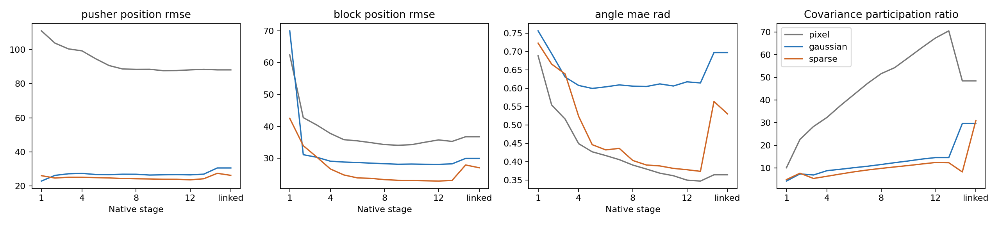
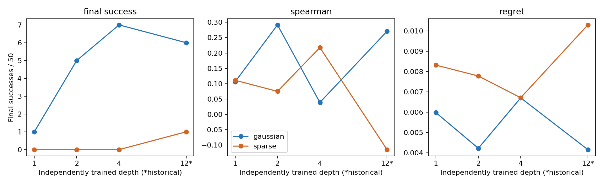

# Encoder depth, physical information and goal retention

Two completed PushT studies answer different questions: layer taps examine how
features change inside a trained 12-block encoder; independent-depth training
examines what a shallower architecture learns from scratch. Both use the matched
seed-0 models. They should not be conflated.

## Layer taps within full-depth encoders

All 12 native CLS outputs plus normalization, projection and linked output were
probed with frozen, train-normalized, validation-selected linear readouts.
Probe train/validation/test partitions contain 512/128/124 episodes, 16 frames each.

| Encoder | Pusher RMSE, block 1 → 12 | Block RMSE, block 1 → 12 | Angle MAE, block 1 → 12 |
|---|---:|---:|---:|
| Pixel | 111.05 → 88.14 | 62.40 → 35.75 | .688 → .350 |
| Gaussian | 22.86 → 26.50 | 69.96 → 28.09 | .756 → .617 |
| Sparse | 26.03 → 23.59 | 42.52 → 22.85 | .723 → .378 |

Positions are pixels; angles radians. Sparse's physical readouts improve through
depth, but the final projector/link can change accessibility again. Pixel retains
better final angle decoding than either JEPA in this panel. Better probes alone
do not establish better planning or uniquely causal physical factors.

Additional panels fit 45 small frozen-feature predictors (three objectives × five
taps × affine/bilinear/MLP), examine controlled perturbations, and intervene on
physical probe subspaces. These are not retrainings of the original AdaLN dynamics.
[Audited figures and CSVs](../results/full-depth) preserve the comparisons. The
later [mechanism follow-up](MECHANISM_FINDINGS.md) adds action-only and shuffled
history controls, magnitude-matched random interventions and broader appearance
perturbations to qualify the interpretation.

## Independently trained shallow encoders

Gaussian and Sparse each trained fresh encoders of depths 1/2/4: 115,308 updates,
batch 32, width 384, history 3, two epochs, same frozen partitions and objectives.
The six-layer predictor is fixed. Twelve-block models are historical references.
There is no independently trained Pixel depth sweep in this study.

| Method | Depth | Final success /50 | Ever success /50 | Candidate Spearman | Regret |
|---|---:|---:|---:|---:|---:|
| Gaussian | 1 | 1 | 12 | .1064 | .005975 |
| Sparse | 1 | 0 | 1 | .1112 | .008315 |
| Gaussian | 2 | 5 | 26 | .2915 | .004220 |
| Sparse | 2 | 0 | 4 | .0750 | .007780 |
| Gaussian | 4 | 7 | 29 | .0390 | .006702 |
| Sparse | 4 | 0 | 7 | .2177 | .006709 |
| Gaussian | 12 | 6 | 30 | .2709 | .004154 |
| Sparse | 12 | 1 | 14 | −.1146 | .010296 |

These are custom short-horizon physical-goal scores, not official PushT scores.
All evaluations use the same 50 goal/candidate banks, ten replans and no
success-based early stop. Ever-success is measured at sampled execution boundaries;
final success remains the predeclared metric. Sparse has better physical probes
at every tested depth, without better final completion. Candidate ranking also
does not track final completion monotonically.

[Complete depth table](../results/independent-depth/depth_summary.csv) includes
linear/MLP probes, uncertainty intervals, parameter counts and costs;
[forecast table](../results/independent-depth/depth_horizons.csv) retains all horizons.

## Reaching and retaining a goal

A retrospective analysis of 450 retained trajectories found that depth-4 Gaussian
reached a goal in 29/50 cases but ended successfully in 7/50; Sparse reached 7/50
and ended successfully in 0/50. All ever-successful cases in both groups had a
later sampled exit, with some Gaussian trajectories subsequently re-entering.
This is not a Sparse-only phenomenon. Retrospective trajectories alone do not
identify its cause; the visited-state follow-up adds diagnostic evidence.

## Interpretation limits

One training seed, exploratory pointwise intervals, small success counts and only
four episodes at H32 limit generalization. Equal updates/data do not equal equal
parameters or FLOPs. Changing depth changes initialization draws. Historical
12-block timing used different hardware/scheduling and cannot establish depth
speedups. A zero success count is not proof of zero population success probability.

This release includes audited compact tables and figures, not all historical
checkpoints/raw evaluation banks. Historical source identifiers and original
artifact hashes are recorded in the update provenance manifest.
